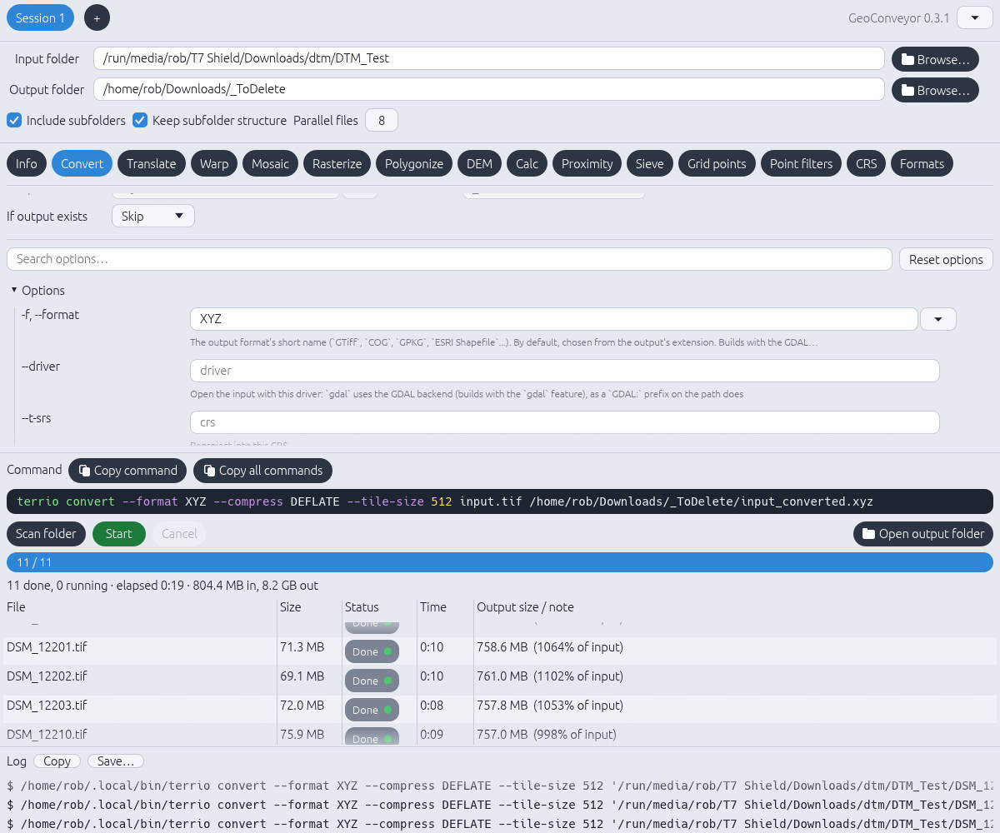

# GeoConveyor

A [Tera Analytics](https://teraanalytics.xyz/geoconveyor) product: a native batch-processing GUI for geospatial data, powered by [terrio](https://github.com/opengeos/terrio). One tab per command (info, convert, translate, warp, mosaic, rasterize, polygonize, dem, calc, proximity, sieve, grid, filter, crs, formats), every option of the installed terrio, folder in → folder out.

Written in Rust with egui. One binary, no Python, no Qt.



## Background

GUIs over command-line geospatial tools have a long history. [OGR2GUI](https://github.com/zer0infinity/OGR2GUI) is one of the originals: a front end for GDAL/OGR's `ogr2ogr` that lets you pick inputs, outputs, projections, SQL queries and spatial filters without hand-writing a command line. It is a Windows x64 fork of Inventis's `ogr2gui`, released under GPL-3.0.

GeoConveyor carries the same idea forward:

| | OGR2GUI | GeoConveyor |
|---|---|---|
| Wraps | `ogr2ogr` (vector conversion) | `terrio` (vector and raster: 15 commands) |
| Options | Fixed set built into the UI | Built from `terrio <command> --help` at start-up, so new flags appear automatically |
| Workflow | One conversion at a time | Whole folders, N files in parallel |
| Platform | Windows | Linux and Windows; builds from source elsewhere |
| Toolkit | C++ | Rust + egui |

Both share the same principle: the GUI never reimplements the tool, it only builds the command for you. Credit to David Tran and the original Inventis authors for showing how useful that is.

## Install

Download `GeoConveyor0_3_1_linux.zip` or `GeoConveyor0_3_1_windows.zip` from the repo root. GeoConveyor needs [terrio](https://github.com/opengeos/terrio) installed separately (see below).

### 1. Install terrio

- **Linux / macOS:** `curl -LsSf https://terrio.opengeos.org/install.sh | sh`
- **Windows (or any OS):** `pip install terrio`

GeoConveyor finds terrio on your PATH (also `~/.local/bin` on Linux and `%APPDATA%\Python\Scripts` on Windows). If it is somewhere else, browse to it in Settings.

### 2. Install GeoConveyor

**Linux (x86-64).** Unzip `GeoConveyor0_3_1_linux.zip`. It holds two options:

- `geoconveyor-linux-x86_64`, a single binary. Make it executable and run it:

  ```
  chmod +x geoconveyor-linux-x86_64
  ./geoconveyor-linux-x86_64
  ```

  Move it somewhere on your PATH (for example `~/.local/bin/geoconveyor`) to launch it from anywhere.
- `GeoConveyor-0.3.1.flatpak`, for a desktop-integrated install with a menu entry and icon:

  ```
  flatpak install --user GeoConveyor-0.3.1.flatpak
  flatpak run xyz.teraanalytics.GeoConveyor
  ```

  The Flatpak sandbox cannot see programs on your system, so it runs your installed terrio through `flatpak-spawn --host`. terrio must therefore be installed on the host as in step 1, not inside the sandbox.

**Windows.** Unzip `GeoConveyor0_3_1_windows.zip`. It holds two options:

- `GeoConveyor-0.3.1-setup.exe`, the installer. Run it and follow the prompts.
- `GeoConveyor-0.3.1-windows-portable.zip`, no install needed. Unzip it anywhere and run `geoconveyor.exe`.

Notes for Windows:

- The binaries are not code-signed yet, so SmartScreen may warn. Choose **More info**, then **Run anyway**.
- terrio's own Windows build needs the Microsoft Visual C++ Redistributable (`VCRUNTIME140.dll`). If terrio will not start, GeoConveyor says so, and the installer offers the download. GeoConveyor itself does not need it.

## Build

```
# Rust toolchain, if you do not have one:  curl --proto '=https' --tlsv1.2 -sSf https://sh.rustup.rs | sh
cargo build --release          # binary: target/release/geoconveyor
cargo test                     # engine tests; need terrio on PATH, skipped otherwise
```

No `-dev` packages are needed on Linux (X11/Wayland/GL are loaded at run time). File dialogs use the desktop portal (`xdg-desktop-portal`, present on standard Ubuntu/GNOME/KDE desktops).

## How it works

- Each tab's form is built at start-up from `terrio <command> --help`, so every flag your terrio has is there, and flags added by a newer terrio appear after Reload.
- Files run N at a time (Parallel files), one terrio process each. Output is written under a `.partial-` name and renamed on success, so a failed or cancelled file leaves nothing behind.
- Copy command / Copy all commands give the exact command lines for scripts.
- Settings (folders, every tab's options) are saved to `~/.config/geoconveyor/settings.json` (`%APPDATA%\geoconveyor\` on Windows).

## Layout

```
src/help.rs     parse clap --help, find terrio, formats
src/specs.rs    per-command facts (patterns, suffix, each/together)
src/model.rs    option fields, forms, per-tab state, saved settings
src/jobs.rs     scan folder, build the terrio command per file, quoting
src/runner.rs   worker pool, temp-then-rename, cancel
src/app.rs      the egui UI (drawing only)
tests/          end-to-end tests with small sample data in tests/data
```

## License

This software is **source-available**, not OSI open source. Who pays depends
on who you are:

| You are… | Cost | Terms |
|---|---|---|
| An individual using it personally | Free | [Additional Permissions](ADDITIONAL-PERMISSIONS.md) §1 |
| A student, teacher, or academic researcher | Free | [Additional Permissions](ADDITIONAL-PERMISSIONS.md) §2 |
| A company with fewer than 100 people **and** under ~US$1M annual revenue | Free | [PolyForm Small Business 1.0.0](LICENSE.md) |
| A larger company | Commercial license | Contact us |
| A government agency, or a contractor working for one | Commercial license | Contact us |

**Commercial licensing:** business@teraanalytics.xyz

Not sure which applies, or working at a nonprofit or public research
organization? Get in touch. Free and discounted licenses are available
case by case.

### Dependencies

This tool is a graphical front end for [terrio](https://github.com/opengeos/terrio), which is installed separately and licensed under the MIT License. terrio is not part of this software, and the licensing terms above do not apply to it.

The licensing terms above apply only to code written by Tera Analytics LLC.

See also [THIRD_PARTY_NOTICES.md](THIRD_PARTY_NOTICES.md).

## Acknowledgements

- [terrio](https://github.com/opengeos/terrio), the engine behind every tab.
- [OGR2GUI](https://github.com/zer0infinity/OGR2GUI) (David Tran, fork of Inventis's ogr2gui), the earlier GUI for `ogr2ogr` that inspired this approach.
- [GDAL/OGR](https://gdal.org), the library both tools ultimately build on.
